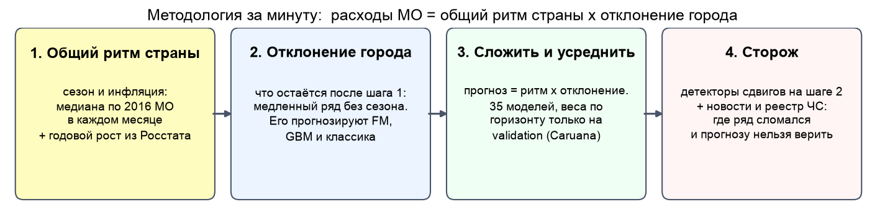
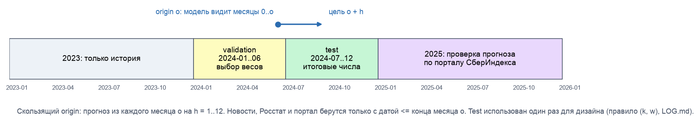
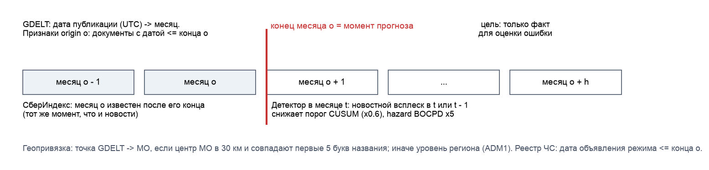
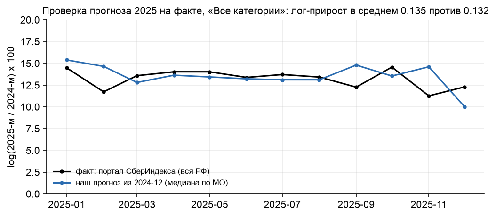

## 0. Карта критериев

| Критерий (вес) | Где в отчёте | Главное число или вывод |
|---|---|---|
| Простота объяснения методологии (10%) | §1, рис. 1; §2 | 4 шага: общий ритм страны, отклонение города, ансамбль, сторож |
| Сравнение моделей, лучше Prophet на 4 горизонтах (20%) | §3 | MAE 306 / 435 / 446 / 658 против 563 / 574 / 652 / 1361; значимо на h = 1, 6, 12 |
| Сравнение методов поиска сдвигов (20%) | §5 | 10 онлайн + 6 офлайн методов при равной частоте ложных тревог; выбор: BOCPD-подтв. |
| Фундаментальные модели (15%) | §4 | на сырых рядах хуже наивной; на локальной компоненте в 1.5-3 раза лучше |
| Интеграция новостей (15%) | §6 | GDELT 1,55 млн документов + реестр ЧС из официальных источников; правило «as-of»; event study паводка |
| Метрики: MAE и R² (10%) | §7 | MAE, R² на уровнях и на изменении, WAPE, MdAPE, смещение, покрытие и WIS интервалов |
| Интерпретация, воспроизводимость, выводы (10%) | §8-10 | проверка прогноза 2025 на факте; `make quick` со свежего клона за 2 минуты |

## 1. Методология за одну страницу

**Задача.** Прогноз средних безналичных расходов на жителя для 2016 муниципальных образований
(МО) по 6 категориям (12 096 рядов) на 1, 3, 6 и 12 месяцев. Поиск точек структурных сдвигов.

**Главная трудность.** В каждом ряду 24 точки (2023-01..2024-12). Перед прогнозом на 12 месяцев
у модели меньше одного года истории. Свою годовую сезонность ряд оценить не может.



1. **Общий ритм страны.** Сезонность и инфляция почти одинаковы для всех МО. Мы берём медиану
   по 2016 МО в каждом месяце. Так сезон оценивается по 2016 рядам, а не по 24 точкам одного ряда.
   Годовой рост на 12 месяцев вперёд берём из оборота розничной торговли Росстата.
2. **Отклонение города.** Остаток после шага 1 — медленный ряд без общего сезона. Его прогнозируют
   фундаментальные модели (FM), градиентный бустинг (GBM) и классические модели.
3. **Сложить и усреднить.** Прогноз = ритм страны × отклонение города. 35 моделей объединяет
   ансамбль. Веса для каждого горизонта выбираются **только на validation**.
4. **Сторож.** Детекторы сдвигов следят за отклонением города. Новости и реестр ЧС подсказывают,
   где искать сдвиг. Сигнал говорит: здесь ряд сломался, прогнозу по старой истории верить нельзя.

**Результат на отложенном окне (test, 2024-07..12), MAE в рублях на жителя в месяц:**

| | h = 1 | h = 3 | h = 6 | h = 12 |
|---|---:|---:|---:|---:|
| Prophet (базовая модель организатора) | 563 | 574 | 652 | 1361 |
| **Ансамбль (наше решение)** | **306** | **435** | **446** | **658** |
| Снижение MAE к Prophet | −46% | −24% | −32% | −52% |
| ΔMAE, 95% ДИ двустороннего бутстрепа (МО × месяц) | [−511; −37] | [−302; +16] | [−353; −66] | [−1110; −430] |
| Значимо при 5%? | да | **нет** | да | да |
| R² на изменении (ансамбль) | 0.42 | 0.59 | 0.53 | −0.17 |
| «Все категории», ансамбль / Prophet | 837 / 1792 | 1147 / 1772 | 1181 / 2057 | 1695 / 4060 |

Ансамбль лучше Prophet на всех четырёх горизонтах по точечной оценке. Разница статистически
значима на h = 1, 6 и 12. На h = 3 ансамбль выигрывает в 5 из 6 месяцев test, но 95% ДИ включает 0.
На h = 3 ни одна из 35 моделей не лучше Prophet значимо (приложение Б). Метод ДИ — в §7.

**Глоссарий.**

| Термин | Значение |
|---|---|
| origin o | месяц, в конце которого делается прогноз; модель видит только месяцы 0..o |
| горизонт h | на сколько месяцев вперёд прогноз; цель — месяц o + h |
| validation / test | целевые месяцы 2024-01..06 (выбор) / 2024-07..12 (итоговая оценка) |
| национальная компонента n | медиана log-расходов по всем МО категории в месяце: сезон и инфляция |
| локальная компонента d | log-расходы МО минус n: отклонение города от страны |
| FM, zero-shot | фундаментальная модель временных рядов; zero-shot — без дообучения на наших данных |
| ансамбль Caruana | жадный отбор моделей с возвращением; вес = доля шагов, на которых модель выбрана |
| R² на изменении | доля объяснённой вариации log(y_цель / y_origin), а не уровней |
| CPD, детектор | метод поиска точки структурного сдвига (change-point detection) |
| BOCPD, CUSUM | байесовский онлайн-детектор длины режима; кумулятивные суммы отклонений |

## 2. Данные и честный протокол

| Источник | Что берём | Лицензия / условия |
|---|---|---|
| СберИндекс, `consumption.parquet` | Средние безналичные расходы на жителя МО, руб./мес., 6 категорий, 2023-01..2024-12 | CC BY-SA 4.0; только для конкурса (Положение §9.2.2) |
| СберИндекс, `market_access.parquet`, справочник МО | Индекс доступности рынков; регион, тип МО, координаты центра, полигоны | то же |
| Росстат, `Oborot_2025.xls` | Оборот розничной торговли РФ по месяцам, 2000-2025 | открытые данные, со ссылкой на источник |
| Производственный календарь РФ | Рабочие и календарные дни месяца | пакет `holidays` (MIT) + постановления Правительства |
| GDELT 1.0 GKG | Темы, места и тональность новостей | свободное использование со ссылкой на GDELT |
| Реестр событий (наш, §6.2) | Режимы ЧС паводка 2024, ключевая ставка, тарифы: даты объявления и вступления, ссылки | официальные сайты МЧС, Правительства, регионов, Банка России |
| Портал СберИндекса, consumer-spending | Национальные расходы по месяцам 2018-2026 | открытые данные; только проверка 2025 и приложение А |

Панель: ряды со всеми 24 месяцами, 2016 МО × 6 категорий = **12 096 рядов**. Двенадцати регионов
в данных нет (Белгородская, Курская обл., Краснодарский край и др.). «Все категории» не равны
сумме пяти категорий (сумма ≈ 72%). Поэтому каждая категория — отдельный ряд. «Все категории»
дают 59% суммы уровней и сильнее всего влияют на общий MAE.



**Протокол.**

- **Скользящий origin.** Прогноз из месяца o на h месяцев вперёд использует только месяцы 0..o.
  Для каждой модели строится «куб» прогнозов: все origin 0..23 и все h = 1..12.
- **Два окна.** Validation: целевые месяцы 2024-01..06. Test: 2024-07..12. Веса ансамбля,
  параметры декомпозиции и выбор моделей делаются на validation.
- **Один взгляд на test в дизайне заголовка.** Правило «отдельные (k, w) для h ≤ 3» (§3.1) мы
  ввели после первого просмотра test. Это одна итерация дизайна, она записана в `LOG.md`. Правило
  улучшило h = 1 и ухудшило h = 3; мы его не откатывали. Других выборов по test в заголовке нет.
  Всё, что сделано позже с просмотром test, вынесено в приложение А с пометкой «пост-hoc».
- **Внешние данные «as-of».** В origin o: Росстат с лагом 2 месяца (данные о ≤ o − 2 уже
  опубликованы), новости с датой публикации ≤ конца месяца o, реестр ЧС с датой объявления ≤ конца
  месяца o. Национальная компонента месяца t использует только данные месяца t.
- **GBM** в origin o обучается только на парах (o', h') с целевым месяцем o' + h' ≤ o.
- **Все модели на всех 12 096 рядах**, включая Prophet. Сравнение парное, на одних и тех же точках.
- **Тесты на утечку** (`make smoke`, `tests/test_leakage.py`): прогноз в origin o и тревога
  детектора в месяце t не меняются, если изменить данные после o (после t).

Ограничение протокола. В validation для h = 12 origin лежат в 2023-01..06 (1-6 месяцев истории).
Веса для длинных горизонтов выбираются в режиме более короткой истории, чем на test.

## 3. Модели прогнозирования и выбор лучшей

### 3.1. Национальная и локальная компоненты

    log y[i,t] = n[c,t] + d[i,t]

- **n[c,t]** — национальная компонента категории c: медиана log y по всем МО в месяце t.
- **d[i,t]** — локальная компонента МО. В ней нет общей сезонности. Она меняется медленно, а
  локальный шок (паводок, закрытие предприятия) даёт в ней ступеньку.


Прогноз национальной компоненты (звёздочка * обозначает прогноз):

    n*[c,T] = n[c,T−12] + G,   G = w · YoY_own(k) + (1 − w) · YoY_Росстат

YoY_own — средний годовой прирост n за последние k месяцев. YoY_Росстат — годовой прирост
оборота розничной торговли со сдвигом 2 месяца. Пока у СберИндекса нет 12 месяцев истории
(origin до 2023-12), G берётся только из Росстата. Так решается задача h = 12: годовой темп роста
приходит из внешнего источника. Параметры на validation: k = 1; w = 0.75 для h = 1-2, 0.25 для
h = 3, 0.5 для остальных. Сезонный профиль Росстата не подошёл (февраль −10% у Росстата, −1% у
СберИндекса), поэтому из Росстата берём только темп роста. Итог: y* = exp(n* + d*).


### 3.2. Модели

| Группа | Модели | Роль |
|---|---|---|
| Наивные | naive, сезонная наивная × собственный YoY (k = 3), × национальный YoY, с учётом сдвигов | Опорные точки |
| Базовая организатора | **Prophet** (Фурье 3-го порядка, мультипликативная), отдельно на каждый ряд и origin | Цель «превзойти Prophet» |
| Классика | AutoETS, AutoTheta, AutoARIMA (statsforecast) | Сравнение |
| Первый бейзлайн | LightGBM v1 на log(y_T/y_o) без декомпозиции | Вклад архитектуры |
| Декомпозиция | n* + d*; d* = persistence / среднее 3 мес. / локальный сезон | Простая сильная модель |
| Фундаментальные | Chronos-Bolt S/B, Chronos-2, Chronos-2 мультивариантный, TimesFM 2.5, TiRex-2, Toto-2.0 22M/313M, Chronos-2 дообученный | §4 |
| GBM | LightGBM и CatBoost на изменении d, прямой мульти-горизонтный | Признаки: лаги d, d год назад, региональный d, рост n*, календарь, FM, новости, CPD |
| Ансамбль | Отбор Caruana (жадный, с возвращением, 20 шагов), отдельно для каждого h, пул соседних h ± 1 | Веса только по validation |

### 3.3. Как выбрана итоговая модель

**Правило выбора (зафиксировано до test):** итоговый прогноз — ансамбль, потому что на
validation он лучше каждой одиночной модели на всех h. Веса ансамбля подбираются на validation.
Пул из 35 моделей зафиксирован в `configs/config.yaml`; `make ensemble` воспроизводит веса бит в бит.

| h | MAE validation: лучшая одиночная | MAE validation: ансамбль* | MAE test: ансамбль | Ранг ансамбля на test (из 36) | Лучшая одиночная на test (известно только после) | Prophet, test |
|---:|---|---:|---:|---:|---|---:|
| 1 | 400 (TimesFM 2.5, декомп.) | 301 | 306 | 10 | 296 (TimesFM 2.5, декомп.) | 563 |
| 3 | 569 (Theta) | 369 | 435 | 2 | 420 (LightGBM v1) | 574 |
| 6 | 540 (TimesFM 2.5, декомп.) | 484 | 446 | **1** | 493 (TimesFM 2.5, декомп.) | 652 |
| 12 | 993 (GBM база) | 800 | 658 | **1** | 691 (декомпозиция) | 1361 |

\* MAE ансамбля на validation посчитано на том же окне, где подобраны веса, и поэтому оптимистично.

Выбор на validation не гарантирует первое место на test. На h = 1 ансамбль 10-й из 36, но
отставание от лучших одиночных моделей (296) не значимо: ΔMAE +9, 95% ДИ [−38; +67]. На h = 3
лучшая на test модель (LightGBM v1, 420) на validation была одной из худших (676); выбрать её
заранее было нельзя. Разница с ней тоже не значима: +15 [−37; +76]. Мы не меняли выбор после test.

### 3.4. Сравнение на test

MAE на **test** (руб. на жителя в месяц). Жирным — лучшая модель в столбце. Полная таблица с
validation, рангами, R² на изменении и ДИ для каждой модели — в приложении Б.

| Модель | h = 1 | h = 3 | h = 6 | h = 12 |
|---|---:|---:|---:|---:|
| Наивная | 624 | 864 | 1124 | 1289 |
| Сезонная наивная × YoY | 340 | 469 | 663 | 1289 |
| **Prophet** | 563 | 574 | 652 | 1361 |
| AutoETS | 634 | 807 | 1036 | 1383 |
| AutoTheta | 614 | 744 | 767 | 922 |
| AutoARIMA | 645 | 862 | 1094 | 1529 |
| LightGBM v1 (без декомпозиции) | 313 | **420** | 761 | 969 |
| TimesFM 2.5, zero-shot на уровнях | 559 | 797 | 1283 | 1691 |
| Chronos-2, zero-shot на уровнях | 613 | 877 | 1361 | 1817 |
| Декомпозиция, d = persistence | 318 | 566 | 526 | 691 |
| TimesFM 2.5 на локальной компоненте | **296** | 522 | 493 | 729 |
| Chronos-2 мультивариантный на лок. комп. | 302 | 531 | 532 | 772 |
| Chronos-2 дообученный на лок. комп. | 308 | 528 | 527 | 771 |
| GBM LightGBM, все признаки | **296** | 532 | 509 | 724 |
| GBM CatBoost, все признаки | 302 | 536 | 513 | 712 |
| **Ансамбль** | 306 | 435 | **446** | **658** |


Выводы.

- **Prophet проигрывает всем моделям на декомпозиции на всех горизонтах** по точечной оценке.
  На 24 точках он переоценивает тренд и плохо переносит декабрьский пик (смещение +6.8% на h = 12).
- **На h = 12 решает архитектура.** Модели без внешней информации о годовом росте (наивная,
  ETS, Prophet) дают 1289-1383. Национальная компонента с ростом Росстата снижает ошибку до 658-729.
- **На h = 1 сильные модели близки (296-318)**, различия между ними не значимы.
- **Состав ансамбля (веса validation):** h = 1 — сезонная наивная с учётом сдвигов 0.35, Theta
  0.25, TimesFM 2.5 0.15; h = 6 — TimesFM 2.5 на локальной компоненте 0.55; h = 12 — GBM 0.45,
  Theta 0.25, Prophet 0.15. Prophet вошёл в ансамбль на h = 12: его ошибки слабо коррелируют с остальными.

### 3.5. Prophet — не соломенное чучело

Сильный результат против слабой настройки базовой модели ничего не стоит. Поэтому мы прогнали
10 конфигураций Prophet (по умолчанию; порядок Фурье 3 и 5; аддитивная и мультипликативная
сезонность; обучение на log y; changepoint_prior_scale 0.01 / 0.05 / 0.5; плоский тренд; сжатая
сезонность) на 400 МО (2400 рядов, по 80 МО из каждого квинтиля уровня), на тех же origin test.
Лучшая конфигурация выбрана **по test** для каждого h — это заведомо в пользу Prophet.

TODO_PG

### 3.6. По категориям (test, MAE)

| Категория | Ансамбль h = 1 / 3 / 6 / 12 | Prophet h = 1 / 3 / 6 / 12 |
|---|---|---|
| Все категории | 837 / 1147 / 1181 / 1695 | 1792 / 1772 / 2057 / 4060 |
| Продовольствие | 428 / 728 / 672 / 839 | 755 / 744 / 768 / 2070 |
| Маркетплейсы | 334 / 401 / 461 / **927** | 526 / 547 / 593 / **825** |
| Транспорт | 85 / 125 / 140 / 190 | 124 / 157 / 206 / 431 |
| Здоровье | 81 / 98 / 91 / 164 | 91 / 106 / 128 / 449 |
| Общественное питание | 69 / 110 / 127 / 136 | 90 / 120 / 161 / 332 |

Главная таблица (§1) — средний MAE по всем 12 096 рядам, то есть по 6 категориям вместе. Строка
«Все категории» — отдельная категория с самыми крупными уровнями. Ансамбль лучше Prophet в 23 из
24 ячеек. Исключение — маркетплейсы на h = 12: рост категории ≈ +45% в год, а рост розничной
торговли Росстата (≈ +15%) его занижает; трендовая экстраполяция Prophet здесь уместнее.

### 3.7. Абляция признаков GBM


Все варианты GBM отличаются от базового не более чем на 1.4%. Новости: +0.4% (h = 1), −0.9%
(h = 12); на подвыборке МО с новостями в 3 месяцах до origin эффект тот же. Признаки сдвигов:
−0.8% на h = 6. FM-признаки: −1.4% на h = 12. Главные признаки (gain): регион, d год назад
относительно origin, месяц цели, категория, изменение регионального d за 3 месяца.

## 4. Фундаментальные модели: где помогают и где нет

Только модели с открытыми весами Apache-2.0, запуск локально (Apple M3 Pro, MPS). Moirai
(CC BY-NC) и TimesFM 3.0 (некоммерческая лицензия) исключены: Положение §10.3 запрещает
технологии, на которые нужны платные права. Способы применения:

1. **Zero-shot на уровнях** — «из коробки».
2. **Zero-shot на локальной компоненте** exp(d); национальная компонента добавляется обратно.
   Chronos-2 мультивариантный: 6 категорий одного МО как одна группа.
3. **Признаки для GBM**: медианный прогноз FM для d и ширина 80% интервала.
4. **Дообучение Chronos-2** (полное, 300 шагов, lr = 1e-5) на локальной компоненте, строго
   каузально: модель, дообученная на месяцах 0..c, применяется к origin c..(следующая отсечка − 1).
   Отсечки 2023-12, 2024-06, 2024-12.


| FM (test, MAE) | уровни h = 1 / 3 / 6 / 12 | лок. компонента h = 1 / 3 / 6 / 12 | покрытие 80% инт., h = 1 / 12 | время, с |
|---|---|---|---|---:|
| Chronos-Bolt S | 707 / 1024 / 1603 / 1986 | 307 / 538 / 539 / 774 | 0.82 / 0.88 | 37 |
| Chronos-Bolt B | 668 / 920 / 1439 / 2015 | 307 / 538 / 529 / 787 | 0.83 / 0.89 | 75 |
| Chronos-2 | 613 / 877 / 1361 / 1817 | 307 / 539 / 540 / 776 | 0.83 / 0.90 | 102 |
| Chronos-2 мультивар. | 588 / 854 / 1351 / 1802 | 302 / 531 / 532 / 772 | 0.81 / 0.91 | 104 |
| Chronos-2 дообуч. | — | 308 / 528 / 527 / 771 | 0.88 / 0.89 | 982 |
| TimesFM 2.5 | 559 / 797 / 1283 / 1691 | **296 / 522 / 493 / 729** | 0.82 / 0.73 | 1028 |
| TiRex-2 | 612 / 870 / 1250 / 1575 | 305 / 535 / 502 / 757 | 0.80 / 0.76 | 3220 |
| Toto-2.0 22M | 595 / 842 / 1122 / 1548 | 313 / 552 / 550 / 799 | 0.74 / 0.88 | 28 |
| Toto-2.0 313M | 611 / 866 / 1240 / 1576 | 310 / 548 / 548 / 794 | 0.82 / 0.87 | 356 |

Время — полный прогон 24 origin × 12 096 рядов на Apple M3 Pro (MPS).

| Где FM помогают | Где FM не помогают |
|---|---|
| На локальной компоненте: MAE в 1.5-3 раза ниже, чем на уровнях; лучше Prophet на всех h | На сырых коротких рядах: при h ≥ 3 все 8 вариантов хуже Prophet и на уровне наивной |
| Средний горизонт: в ансамбле FM дают −5.9% MAE на h = 6 (446 против 473 без FM) | h = 12: FM экстраполируют локальный тренд (TimesFM 729 против persistence 691) |
| h = 1-3: TimesFM лучше persistence (296 против 318 на h = 1) | В ансамбле на h = 3 веса FM не перенеслись с validation (+2.4% MAE) |
| Chronos-2 мультивариантный: совместная динамика категорий (302 против 307) | Как признаки GBM: ±1%, GBM уже видит те же лаги |
| Дообучение Chronos-2: −2% на h = 3-6, покрытие на h = 1 0.88 против 0.83 | Дообучение дорого (16 мин) при 24 месяцах данных; эффект скромный |
| Семейство Chronos: откалиброванные 80% интервалы (0.81-0.91) | TimesFM 2.5: узкие интервалы на h = 12 (покрытие 0.73) |

Причина провала на уровнях: ряды из 7-23 точек с сильным декабрьским пиком. Модель не знает
календарь и не может выучить сезон из одного года. Декомпозиция убирает сезон до FM, и FM
получает то, что умеет прогнозировать: гладкий ряд без календарного эффекта.

## 5. Структурные сдвиги

### 5.1. Методы

Сдвиг ищем в локальной компоненте d (сезон и инфляция уже убраны). Ряд стандартизуется робастным
масштабом месячных изменений в 2023 г. (MAD).

| Детектор | Идея |
|---|---|
| Скачок (spike) | \|Δz_t\| > k: скачок за один месяц |
| CUSUM | двусторонние кумулятивные суммы отклонений от уровня 2023 г., перезапуск после тревоги |
| PELT, BinSeg, Window (ruptures) | переподгонка сегментации на z[0..t]; тревога, если последний разрыв свежий |
| BOCPD (Adams, MacKay 2007) | апостериорное распределение длины текущего режима, модель Normal-Gamma, hazard 0.05 |
| BOCPD-подтв. | то же, но новый режим должен продержаться 2 месяца (устойчив к выбросам) |
| CUSUM по остаткам | CUSUM на ошибках локальной сезонной наивной модели |
| CUSUM / BOCPD + новости | порог CUSUM × 0.6 или hazard BOCPD × 5 в месяц новостного всплеска и следующий |

Офлайн-методы (весь ряд сразу): PELT, BinSeg, BottomUp, Window, KernelCPD (rbf), MAP-сегментация BOCPD.

**Честное сравнение.** У каждого онлайн-детектора один порог. Его калибруем на половине рядов
так, чтобы частота ложных тревог на чистых рядах была ≤ 2% на ряд-месяц. Метрики считаем на
другой половине. Без такой калибровки любой детектор можно сделать сколь угодно чувствительным.

**Синтетика.** В реальные ряды d («Все категории», 400 МО) вставляем в случайный месяц
2024-02..10 ступеньку 5/10/20/30%, излом тренда 2/4% в месяц или одномесячный выброс 20%
(выброс — не структурный сдвиг: хороший детектор его игнорирует). Метрики: recall и precision с
допуском 2 месяца, F1, средняя задержка, частота ложных тревог.


### 5.2. Таблица решений

Все детекторы откалиброваны на одну частоту ложных тревог (≈ 1-2%), поэтому recall в таблице —
это recall при фиксированной частоте ложных тревог.

TODO_DT

Офлайн (весь ряд, допуск 1 месяц), F1 при сдвиге 10 / 20%: Window 0.71 / 0.82, PELT 0.66 / 0.76,
BinSeg 0.66 / 0.77, BOCPD-MAP 0.59 / 0.69, BottomUp 0.58 / 0.68, KernelCPD 0.57 / 0.72.

TODO_CHOICE

### 5.3. Реальные данные

Тревоги по месяцам 2024 г. (2016 МО, «Все категории»): BOCPD 13-53 в месяц, PELT 26-66; у CUSUM
число тревог растёт к концу года (с 0 до 91): он накапливает медленный локальный дрейф. Всплеск
CUSUM по остаткам в 2024-04 (100 тревог) — артефакт: его эталон «год назад» — апрель 2023, где у
многих МО разрыв в исходных данных (в офлайн-PELT 341 разрыв из 986 приходится на 2023-04).

**Паводок в Орске (прорыв дамбы 5 апреля 2024).** Локальная компонента Орска выросла с +16% к
национальному уровню (апрель) до +24% (май), затем вернулась к +16-17% к августу. В GDELT за
апрель 2024 об Орске 1 367 документов, 1 336 с темой «наводнение» (обычно 0-10 в месяц). Сдвиг +7%
обычные детекторы не видят; CUSUM поднимает тревогу в июне, **CUSUM с новостным prior — в мае**,
на месяц раньше.


### 5.4. Как учёт сдвигов улучшает прогноз

Модели с «памятью» о прошлом годе (сезонная наивная, Prophet, признак «d год назад» в GBM) после
сдвига опираются на старый уровень. Поправка: после тревоги точка сдвига уточняется (разбиение с
минимальной суммой квадратов в окне [тревога − 3; тревога]), история до сдвига переносится на
новый уровень, и только потом считается прогноз.

| Синтетика, сдвиг 15%, MAE (руб.) | h = 1 | h = 2 | h = 3 | h = 6 |
|---|---:|---:|---:|---:|
| Локальная сезонная модель (YoY за 3 мес.) | 947 | 1022 | 1164 | 1567 |
| То же с поправкой на сдвиг | **819** | **920** | **1032** | **1397** |
| Изменение | −14% | −10% | −11% | −11% |

На реальных данных (test) поправка затрагивает 15% рядов на h = 1 и даёт на них −0.3% MAE на h = 1
и −1.3% на h = 3. Эта модель получила наибольший вес в ансамбле на h = 1 (0.35).

## 6. Интеграция новостей и событий

### 6.1. GDELT

1. **Сбор.** Ежедневные файлы GDELT GKG 1.0 за 2022-12..2024-12 (761 день, ≈ 33 ГБ; 2023-03-23
   на сервере отсутствует). Документы с городом или регионом РФ: **1,55 млн**.
2. **Привязка к МО.** GDELT геокодирует шумно (украинские топонимы попадают в российские регионы,
   фамилии распознаются как сёла). Точку GDELT привязываем к МО, только если (а) центр МО в 30 км
   и (б) транслитерация названия начинается с тех же 5 букв. Так 942 места привязаны к 811 МО;
   в панели новости есть у 575 МО. Остальные места — на уровне региона (ADM1, 81 регион). Таблица
   привязки для аудита: `data/external/news_location_match.csv`.
3. **Темы.** Группы тем GKG: бедствие, наводнение, пожар, экономика-негатив, цены, инфраструктура,
   безопасность. Тему MANMADE_DISASTER_IMPLIED исключаем: GDELT ставит её на большинство военных текстов.
4. **Признаки** на месяц t: log(1 + число документов), «сюрприз» (отклонение от среднего за
   6 месяцев), число документов по темам, тональность; то же для региона.

### 6.2. Реестр событий из официальных источников

GDELT — англоязычные СМИ, малые МО почти не упоминаются. Поэтому мы вручную собрали реестр
событий из русскоязычных официальных источников: режимы ЧС паводка весны 2024 (сайты МЧС,
правительств регионов), решения Банка России по ключевой ставке, индексация тарифов ЖКХ, конец
массовой льготной ипотеки. В каждой строке: дата объявления, дата вступления в силу, МО или
регион, ожидаемый знак эффекта, ссылка на источник, признак «проверено» (страница открыта и
подтверждает дату). Файл: `data/external/event_registry.csv`. Тексты страниц использовались только
как данные: даты, названия МО, номера актов.

TODO_REG

### 6.3. Правило согласования новостей с данными



| Что | Правило |
|---|---|
| Дата документа | GDELT `DATE` = дата публикации (UTC). Документ относится к календарному месяцу публикации |
| Признаки для origin o | документы с датой ≤ конца месяца o. Месяц o СберИндекса тоже известен только после его конца, поэтому новости и расходы имеют одинаковый момент «as-of» |
| Prior детектора в месяце t | всплеск новостей в месяце t или t − 1 (оба известны в конце t) |
| Реестр ЧС | событие используется с месяца даты **объявления**; дата вступления — для event study |
| Место | точка GDELT → МО (30 км + 5 букв названия), иначе регион; реестр — МО из официального акта |
| Будущее | ни один признак не использует документы после конца месяца o |

Событие и публикация — не одно и то же. Новость о паводке выходит в день события или позже; акт
о ЧС — в день объявления режима. Для прогноза важна дата, когда информация стала доступна, поэтому
в признаках используется дата публикации, а не дата события.

### 6.4. Что дают новости: результаты, включая нулевые

| Использование | Результат |
|---|---|
| Признаки GBM | эффект на MAE ±1% (§3.7): новости редки (575 из 2016 МО) и англоязычны |
| Prior для CUSUM, Орск | тревога в мае 2024 вместо июня, на месяц раньше |
| Prior, полусинтетика (сдвиг 10%) | CUSUM + новости F1 0.43 против 0.38, задержка 1.1 против 1.5 мес.; BOCPD + новости 0.73 против 0.78 (хуже: рост hazard добавляет ложные тревоги) |
| Разметка событий GDELT (53 МО-месяца) | lift CUSUM 1.5, CUSUM + новости 1.5, BOCPD 0 |
| Event study по реестру ЧС | §6.5 |

Вывод: новостной prior полезен медленному детектору (CUSUM) и не нужен быстрому (BOCPD). В прогнозе
уровня новости почти ничего не дают; их ценность — в поиске и объяснении шоков.

### 6.5. Event study: паводок 2024

TODO_ES

## 7. Метрики

| Метрика | Ансамбль h = 1 / 3 / 6 / 12 | Prophet h = 1 / 3 / 6 / 12 | Что показывает |
|---|---|---|---|
| MAE, руб. | 306 / 435 / 446 / 658 | 563 / 574 / 652 / 1361 | средняя ошибка в рублях (обязательная) |
| R² (уровни) | 0.998 / 0.996 / 0.995 / 0.991 | 0.991 / 0.992 / 0.990 / 0.954 | почти всегда ≈ 1: уровни МО сильно различаются |
| R² на изменении log(y_T/y_o) | 0.42 / 0.59 / 0.53 / −0.17 | −2.6 / −0.86 / −8.4 / −167 | объясняет ли модель динамику |
| WAPE | 3.3% / 4.7% / 4.9% / 7.2% | 6.1% / 6.3% / 7.1% / 14.8% | ошибка в % от суммы факта |
| MdAPE | 3.7% / 5.3% / 5.4% / 8.1% | 5.6% / 6.3% / 7.5% / 16.7% | типичная ошибка ряда в % |
| Смещение | +0.7% / +1.2% / −0.4% / +0.3% | −0.6% / −0.5% / −1.6% / +6.8% | систематический сдвиг прогноза |
| Покрытие 80% интервала | 0.81 / 0.74 / 0.67 / 0.76 | 0.87 / 0.90 / 0.87 / 0.93 | честность интервала (цель 0.80) |
| WIS (80% интервал + медиана), руб. | 211 / 302 / 333 / 516 | 485 / 448 / 503 / 1205 | точность интервала и медианы вместе |

**Интерпретация.** R² на уровнях не различает модели. R² на изменении показывает, что ансамбль
объясняет 42-59% вариации изменения расходов за 1-6 месяцев. На h = 12 он отрицательный: годовой
рост в основном общий для всех МО, а ошибка оценки общего роста (≈ 1 п.п.) больше, чем различия
между МО. Prophet на изменении хуже константы на всех горизонтах.

**Интервалы.** 80% интервал строится по квантилям 10% и 90% логарифмических ошибок на
**validation** (по горизонту и категории) и проверяется на test. У ансамбля покрытие ниже
номинала на h = 3-12 (0.67-0.76): ошибки на test больше, чем на validation. У Prophet покрытие
выше номинала, потому что его ошибки на validation велики и интервалы широкие. WIS учитывает
обе стороны; у ансамбля он в 1.5-2.3 раза ниже.

**Значимость.** ΔMAE = MAE(модель) − MAE(Prophet) на одних и тех же рядах и месяцах. 95% ДИ —
**двусторонний бутстреп**: независимо пересэмплируются МО (6 категорий МО вместе) и целевые
месяцы test, 1000 повторов. Бутстреп только по МО даёт слишком узкие ДИ: ошибки всех МО в одном
месяце связаны через общую национальную компоненту. Дополнительно — тест Диболда-Мариано с
поправкой HLN по 6 месячным разностям (при 6 месяцах мощность низкая; для h ≥ 6 не определён).

| Ансамбль против Prophet | h = 1 | h = 3 | h = 6 | h = 12 |
|---|---|---|---|---|
| ΔMAE, руб. | −258 | −140 | −207 | −702 |
| 95% ДИ, двусторонний бутстреп | [−511; −37] | [−302; +16] | [−353; −66] | [−1110; −430] |
| 95% ДИ, только по МО (для сравнения) | [−263; −253] | [−145; −134] | [−215; −199] | [−722; −682] |
| DM-HLN, p | 0.11 | 0.44 | — | 0.003 |
| Месяцев test, где ансамбль лучше | 5 из 6 | 5 из 6 | 5 из 6 | 6 из 6 |


## 8. Выводы, практическая ценность, проверка на 2025

### 8.1. Прогноз на 2025 год

Финальный прогноз (origin 2024-12, h = 1..12) делает тот же ансамбль; веса выбраны заново на
validation + test. 80% интервал — квантили 10% и 90% логарифмических ошибок ансамбля на test
по горизонту и категории. Файл `results/forecast_2025.csv` (145 152 строки).


Медианный прогноз декабря 2025 к декабрю 2024: все категории +10.5%, маркетплейсы +24.6%,
общественное питание +13.6%, транспорт +9.9%, здоровье +7.1%, продовольствие +6.2%.

### 8.2. Проверка прогноза 2025 на факте

Прогноз 2025 сделан в конце 2024 г. Сейчас (октябрь 2026) на портале СберИндекса есть
национальные расходы за 2025 год. Это единственная проверка на данных, которых не видел ни один
этап разработки. Панель — медиана по МО на жителя, портал — сумма по РФ. Поэтому сравниваем
годовой прирост log(2025-m / 2024-m), а не уровни.



| «Все категории» | Прогноз / панель | Факт портала | Разница |
|---|---:|---:|---:|
| Годовой log-прирост 2025, среднее за 12 месяцев | 0.135 (+14.5%) | 0.132 (+14.1%) | +0.3 п.п. |
| Тот же прирост за 2024: факт панели против портала | 0.139 | 0.149 | −1.0 п.п. |

Для «Всех категорий» прогноз роста 2025 совпал с фактом с точностью 0.3 п.п.; источники в 2024 г.
расходятся на 1.0 п.п., то есть сравнение корректно. По отдельным категориям сравнение грубое:
типы портала не совпадают с категориями панели (у маркетплейсов разница источников за 2024 г.
28.7 п.п.; у общепита на портале в 2025 г. скачок +40%).

### 8.3. Практические выводы

- **Для прогноза по МО на короткой истории главное — отделить общую динамику.** Декомпозиция с
  persistence уже снижает MAE к Prophet на 44% / 1% / 19% / 49%.
- **Годовой горизонт требует внешнего источника роста.** Без него h = 12 не прогнозируется.
  Проверка 2025 показывает, что внешний рост (Росстат) переносится на следующий год.
- **Фундаментальные модели стоит применять к очищенному от сезонности сигналу**, а не к «сырым»
  коротким рядам; лучший выигрыш — на среднем горизонте (h = 6).
- **Мониторинг шоков.** BOCPD с подтверждением даёт устойчивые сигналы с задержкой ~1 месяц;
  CUSUM с prior из новостей ловит слабый сдвиг в Орске на месяц раньше.
- **Локальный шок не обязательно долгий.** В Орске всплеск расходов после паводка продлился
  ~3 месяца; прогноз после сдвига должен переоценивать уровень, а не продлевать скачок.

## 9. Ограничения

- 24 месяца: окно validation для h = 12 короче по истории, чем test (§2).
- Один взгляд на test в дизайне заголовка: правило «отдельные (k, w) для h ≤ 3» (§2, `LOG.md`).
  Пост-hoc эксперименты (приложение А) смотрели на test ещё 5 раз и в заголовок не входят.
- На h = 3 выигрыш у Prophet не значим (§7). Все ДИ построены по 6 месяцам test: это мало.
- Нет настоящей разметки шоков; проверка — по реестру ЧС, новостям и примерам.
- GDELT GKG 1.0 — только англоязычные источники; реестр ЧС собран вручную и неполон.
- Фундаментальные модели обучались на открытых корпусах; мы не можем исключить, что в них есть
  ряды за 2024 г. (не данные СберИндекса).
- Проверка 2025 — одна национальная цифра для «Всех категорий»; факт 2025 по МО недоступен.

## 10. Воспроизводимость

```bash
make setup         # uv + Python 3.13, точные версии из requirements.lock.txt
make data          # данные СберИндекса, справочник МО, Росстат, портал (≈ 50 МБ)
make quick         # свежий клон: тесты на утечку + пересчёт всех главных чисел (≈ 2 мин)
make reproduce     # полный прогон: модели, FM, CPD, новости, ансамбль, прогноз, рисунки, отчёт (4-5 ч)
```

- `make quick` на свежем клоне запускает `make smoke` (тесты на утечку и проверка формы, секунды)
  и `make verify`: пересчёт MAE, R², R² на изменении, MAE по категориям, ДИ двустороннего
  бутстрепа, DM-HLN и прогноза 2025 из `results/verify/cubes.npz` (8 МБ: прогнозы 8 ключевых моделей
  на test) со сверкой с таблицами `results/metrics/`. Если есть полный кэш `results/cache/`, `make
  quick` пересобирает ансамбль, таблицы, рисунки и отчёт.
- Все параметры — в `configs/config.yaml` (окна, сетки, гиперпараметры, пул ансамбля, список FM,
  темы новостей). Каждый шаг — отдельный скрипт в `src/` с инструкцией в начале файла.
- Полный прогон на Apple M3 Pro: Prophet ≈ 50 мин, statsforecast ≈ 45 мин, FM ≈ 1.5 ч, GBM ≈ 1.5 ч,
  загрузка GDELT ≈ 1-2 ч. Журнал экспериментов со всеми итерациями — `LOG.md`.
- Данные организатора в репозиторий не входят (Положение §9.2.2).

При разработке кода использовались инструменты ИИ-ассистирования (Claude Code). Все решения,
результаты и текст проверены автором; автор отвечает за проект.

## Приложение А. Пост-hoc эксперименты (не используются для выбора)

Всё в этом разделе сделано **после** фиксации решения, с просмотром test (4 раза для ансамбля v2,
1 раз для варианта nat3). Числа на test здесь — не независимая оценка. Заголовок (§1) остаётся v1.

**Диагностика.** Если заменить прогноз национальной компоненты на факт (оракул), test MAE
декомпозиции падает с 318 / 566 / 526 / 691 до 252 / 366 / 419 / 394. Главный источник ошибки —
национальная компонента (6 рядов), а не локальная модель. Эта диагностика смотрела на test.

**Национальная компонента v3** (выбрана на validation). Ряд портала СберИндекса (национальные
расходы, в origin o только месяцы ≤ o) вместо Росстата; для o ≥ 12 — среднее с Росстатом по
категориям. Validation MAE декомпозиции с persistence: 428 / 682 / 587 / 1058 → 348 / 429 / 525 /
735. Ограничение: портал скачан в винтаже 2026-10, поздние пересмотры данных 2023-2024 могли
попасть в прошлое.

| Test MAE | h = 1 | h = 3 | h = 6 | h = 12 |
|---|---:|---:|---:|---:|
| v1, заголовок | 306 | 435 | 446 | 658 |
| nat3: тот же отбор Caruana, пул v1 + декомпозиция на национальной v3 | 291 | 451 | 487 | 542 |
| nat3 − v1, двусторонний 95% ДИ | −15 [−40; +10] | +16 [−2; +32] | +41 [−10; +99] | **−117 [−176; −63]** |
| v2: стекинг (`src/stack.py`), выбор пула и схемы после test | 268 | 393 | 568 | 586 |
| v2 − v1, двусторонний 95% ДИ | −37 [−79; +1] | −42 [−80; 0] | **+122 [+25; +218]** | −72 [−189; +35] |

- **nat3** (вариант предрегистрирован в `LOG.md` до просмотра test): значимо лучше v1 только на
  h = 12 (−18%, DM-HLN p = 0.02); на h = 1-6 разница не значима. Проверка 2025 для «Всех категорий»:
  0.137 против факта 0.132 (v1: 0.135).
- **v2** не лучше v1 значимо ни на одном горизонте и значимо хуже на h = 6 (продовольствие и
  маркетплейсы в 2024-H2 замедлились, а ряд портала нет). Проверка 2025: 0.130 против 0.132.
- Вывод: портал как источник национального роста полезен на годовом горизонте. Это направление
  для следующей версии, а не замена заголовка, выбранного по честному протоколу.

## Приложение Б. Все модели: validation, test, ранги, R², значимость

Ранг — место среди 35 кандидатов и ансамбля на test (1 = лучший). ΔMAE к Prophet — двусторонний
95% ДИ. MAE ансамбля на validation посчитано на окне подбора весов.

TODO_APPB

## Источники

- СберИндекс, данные конкурса: https://sber.ru/sberindex/konkurs_sberindex (CC BY-SA 4.0).
- Портал СберИндекса, consumer-spending: https://sberindex.ru.
- Росстат, оборот розничной торговли: https://rosstat.gov.ru/statistics/roznichnayatorgovlya.
- The GDELT Project, GKG 1.0: https://www.gdeltproject.org.
- МЧС России, правительства регионов, Банк России: ссылка на каждый акт — в `data/external/event_registry.csv`.
- Ansari et al. Chronos (2024); Chronos-2 (2025), amazon/chronos-2, Apache-2.0.
- Das et al. TimesFM (2024); google/timesfm-2.5-200m-pytorch, Apache-2.0.
- NX-AI TiRex-2 (2026), Apache-2.0. Datadog Toto 2.0 (2026), Apache-2.0.
- Adams R., MacKay D. Bayesian Online Changepoint Detection (2007).
- Truong C., Oudre L., Vayatis N. Selective review of offline change point detection methods (ruptures), 2020.
- Caruana R. et al. Ensemble Selection from Libraries of Models, ICML 2004.
- Diebold F., Mariano R. (1995); Harvey D., Leybourne S., Newbold P. (1997): тесты точности прогнозов.
- Gneiting T., Raftery A. Strictly proper scoring rules (2007); Bracher J. et al. WIS (2021).
- Taylor S., Letham B. Forecasting at Scale (Prophet), 2018.
