## 1. Кратко

**Задача.** Прогноз средних безналичных расходов на жителя для 2016 муниципальных образований
(МО) по 6 категориям (12 096 рядов) на 1, 3, 6 и 12 месяцев; поиск точек структурных сдвигов.

**Главная трудность.** В каждом ряду 24 точки (2023-01..2024-12). Перед прогнозом на 12 месяцев
у модели меньше одного года истории: собственную годовую сезонность ряда оценить нельзя.

**Решение.** Мы раскладываем ряд на национальную компоненту (сезонность и инфляция, общие для
всех МО; оцениваются по поперечному срезу из 2016 МО, рост на год вперёд берётся из данных
Росстата) и локальную компоненту МО. Локальную компоненту прогнозируют 8 вариантов открытых
фундаментальных моделей пяти семейств, GBM и классические модели. Ансамбль Caruana выбирает веса по горизонтам
**только на validation**. Структурные сдвиги ищут 10 онлайн-детекторов (2 из них с новостями) и 6 офлайн-методов,
откалиброванных на одинаковую частоту ложных тревог. Новости GDELT (1,55 млн документов)
дают признаки и априорную информацию для детекторов.

**Результат на отложенном окне (test, 2024-07..12), MAE, руб. на жителя в месяц:**

| Модель | h = 1 | h = 3 | h = 6 | h = 12 |
|---|---:|---:|---:|---:|
| Prophet (базовая модель организатора) | 563 | 574 | 652 | 1361 |
| **Ансамбль (наше решение)** | **306** | **435** | **446** | **658** |
| Снижение MAE к Prophet | −46% | −24% | −32% | −52% |

Разница с Prophet значима на всех горизонтах: 95% доверительный интервал кластерного бутстрепа
по МО целиком ниже нуля (раздел 6.2). R² на уровнях 0.998 / 0.996 / 0.995 / 0.991.

## 2. Данные

| Источник | Что берём | Лицензия / условия |
|---|---|---|
| СберИндекс, `consumption.parquet` | Средние безналичные расходы на жителя МО, руб./мес., 6 категорий, 2023-01..2024-12 | CC BY-SA 4.0; только для конкурса (Положение §9.2.2) |
| СберИндекс, `market_access.parquet`, справочник МО | Индекс доступности рынков; регион, тип МО, координаты центра, полигоны | то же |
| Росстат, `Oborot_2025.xls` | Оборот розничной торговли РФ по месяцам, 2000-2025 | открытые данные Росстата, со ссылкой на источник |
| Производственный календарь РФ | Рабочие и календарные дни месяца | пакет `holidays` (MIT) + постановления Правительства о переносе дней |
| GDELT 1.0 GKG | Темы, места и тональность новостей | свободное использование со ссылкой на GDELT Project |

Панель. Берём ряды, у которых есть все 24 месяца: 2016 МО × 6 категорий = **12 096 рядов**.
Двенадцать регионов в данных отсутствуют (Белгородская, Курская, Краснодарский край и др.).
«Все категории» не равны сумме пяти категорий (сумма ≈ 72% от «Всех категорий»), поэтому
категории прогнозируются как отдельные ряды. Категория «Все категории» даёт 59% суммы уровней,
поэтому она сильнее всего влияет на общий MAE; таблица по категориям — в разделе 6.4.

## 3. Протокол оценки (без утечки)

- **Скользящий origin.** Прогноз из месяца o на h месяцев вперёд использует только месяцы 0..o.
  Для каждой модели строится «куб» прогнозов: все origin 0..23 и все h = 1..12.
- **Два окна.** Validation: целевые месяцы 2024-01..2024-06. Test: 2024-07..2024-12.
  Веса ансамбля, параметры декомпозиции и выбор моделей делаются **только на validation**.
  Все итоговые числа — на test, на котором ничего не настраивалось.
- **Обучение GBM** в origin o: только пары (o', h') с целевым месяцем o' + h' ≤ o.
- **Горизонты** 1, 3, 6, 12 (по условию) и кривая для всех h = 1..12.
- **Все модели на всех 12 096 рядах**, включая Prophet. Сравнение парное, на одних и тех же точках.
- **Метрики.** MAE в рублях (обязательная). R² на уровнях. **R² на изменении** log(y_T / y_o):
  R² на уровнях почти всегда ≈ 0.99, потому что уровни МО сильно различаются; R² на изменении
  показывает, объясняет ли модель динамику. WAPE, медиана абсолютной процентной ошибки (MdAPE),
  смещение (Bias, % суммы факта).
- **Значимость.** Разница MAE с Prophet и 95% доверительный интервал: кластерный бутстреп по
  МО (1000 повторов). Шесть категорий одного МО остаются вместе.

Ограничение протокола. В validation для h = 12 origin лежат в 2023-01..2023-06 (1-6 месяцев
истории). Поэтому веса для длинных горизонтов выбираются в режиме более короткой истории,
чем на test. Мы не меняем окна под test и показываем это как ограничение.

## 4. Архитектура: национальная и локальная компоненты

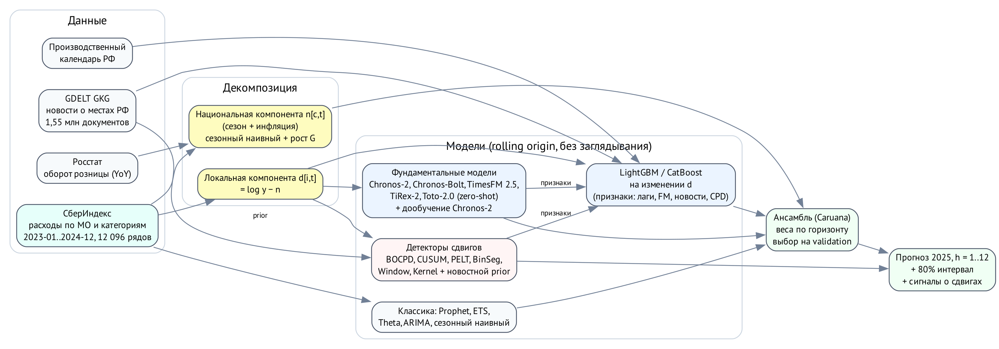

Сезонность и инфляция почти одинаковы для всех МО. Их можно оценить по поперечному срезу из
2016 МО, а не по 24 точкам одного ряда:

    log y[i,t] = n[c,t] + d[i,t]

- **n[c,t]** — национальная компонента категории c: медиана log y по всем МО в месяце t.
  Она известна в месяце t (использует только данные месяца t).
- **d[i,t]** — локальная компонента МО: отклонение от национального уровня. В ней нет общей
  сезонности. Она меняется медленно, а локальный шок (паводок, закрытие предприятия) даёт в
  ней ступеньку.

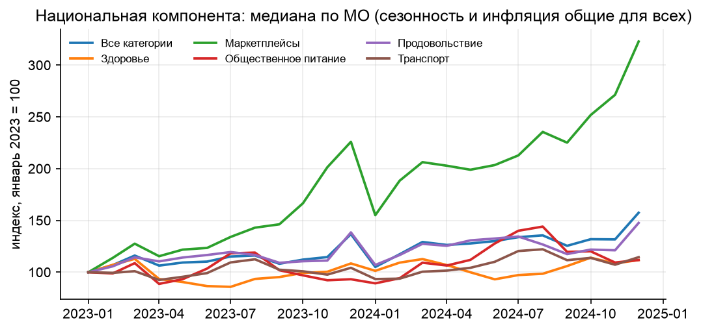

Прогноз национальной компоненты (звёздочка * обозначает прогноз):

    n*[c,T] = n[c,T−12] + G,   G = w · YoY_own(k) + (1 − w) · YoY_Росстат

YoY_own — средний годовой прирост n за последние k месяцев. YoY_Росстат — годовой прирост
оборота розничной торговли со сдвигом 2 месяца (к моменту прогноза данные уже опубликованы).
Пока у СберИндекса нет 12 месяцев истории (origin до 2023-12), G берётся только из Росстата.
Это решает задачу h = 12: годовой темп роста приходит из внешнего источника, а не из 7-11 точек.
Параметры (k, w) выбираются на validation по сетке: k = 1; w = 0.75 для h = 1-2, 0.25 для h = 3,
0.5 для остальных горизонтов (для h ≥ 4 одна общая пара, потому что в validation у этих
горизонтов почти нет origin с годом истории). Сезонный профиль Росстата как априорная
сезонность не подошёл: он плохо совпадает с профилем СберИндекса (февраль −10% у Росстата,
−1% у СберИндекса), поэтому из Росстата берём только темп роста.

Прогноз локальной компоненты d*[i,T] даёт одна из моделей раздела 5. Итог: y* = exp(n* + d*).

## 5. Модели прогнозирования

| Группа | Модели | Роль |
|---|---|---|
| Наивные | naive, сезонная наивная, сезонная наивная × собственный YoY (k=3), × национальный YoY, дрейф | Опорные точки |
| Базовая организатора | **Prophet** (годовая сезонность Фурье 3-го порядка, мультипликативная), отдельная модель на каждый ряд и origin | Цель «превзойти Prophet» |
| Классика | AutoETS, AutoTheta, AutoARIMA (statsforecast) | Сравнение |
| Первый бейзлайн | LightGBM v1 на log(y_T/y_o) без декомпозиции | Вклад архитектуры |
| Декомпозиция | n* + d*; d* = persistence / среднее 3 мес. / локальный сезон | Простая сильная модель |
| Фундаментальные | Chronos-Bolt S/B, Chronos-2, Chronos-2 мультивариантный, TimesFM 2.5, TiRex-2, Toto-2.0 22M/313M, Chronos-2 дообученный | Раздел 6.3 |
| GBM | LightGBM и CatBoost на изменении d, прямой мульти-горизонтный | Признаки: лаги d, d год назад, региональный d, рост n*, календарь, FM, новости, CPD |
| С учётом сдвигов | сезонная наивная с поправкой истории после тревоги CUSUM | Раздел 7.4 |
| Ансамбль | Отбор Caruana (жадный, с возвращением, 20 шагов), отдельно для каждого h, пул соседних h ± 1 | Веса только по validation |

Фундаментальные модели — только с открытыми весами Apache-2.0, запуск локально (Apple M3 Pro, MPS).
Moirai (CC BY-NC) и TimesFM 3.0 (некоммерческая лицензия) исключены: Положение §10.3 запрещает
технологии, на которые нужны платные права, а победитель передаёт Сберу лицензию на решение.

Способы применения FM:

1. **Zero-shot на уровнях** — как «из коробки».
2. **Zero-shot на локальной компоненте** exp(d). FM прогнозирует d, национальная компонента
   добавляется обратно. Для Chronos-2 есть мультивариантный режим: 6 категорий одного МО
   подаются как одна группа, модель учитывает их совместную динамику.
3. **Признаки для GBM**: медианный прогноз FM для d и ширина 80% интервала.
4. **Дообучение Chronos-2** (полное, 300 шагов, lr = 1e-5) на локальной компоненте, строго
   каузально: модель, дообученная на месяцах 0..c, применяется к origin c..(следующая отсечка − 1).
   Отсечки 2023-12, 2024-06, 2024-12. Время: 5-6 минут на отсечку на ноутбуке.

## 6. Результаты прогнозирования

### 6.1. Сравнение моделей

MAE на **test** (руб. на жителя в месяц). Жирным — лучшая модель в столбце.

| Модель | h = 1 | h = 3 | h = 6 | h = 12 |
|---|---:|---:|---:|---:|
| Наивная | 624 | 864 | 1124 | 1289 |
| Сезонная наивная × YoY | 340 | 469 | 663 | 1289 |
| **Prophet** | 563 | 574 | 652 | 1361 |
| AutoETS | 634 | 807 | 1036 | 1383 |
| AutoTheta | 614 | 744 | 767 | 922 |
| AutoARIMA | 645 | 862 | 1094 | 1529 |
| LightGBM v1 (без декомпозиции) | 313 | **420** | 761 | 969 |
| TimesFM 2.5, zero-shot на уровнях | 559 | 797 | 1283 | 1691 |
| Chronos-2, zero-shot на уровнях | 613 | 877 | 1361 | 1817 |
| Декомпозиция, d = persistence | 318 | 566 | 526 | 691 |
| TimesFM 2.5 на локальной компоненте | 296 | 522 | 493 | 729 |
| Chronos-2 мультивариантный на лок. комп. | 302 | 531 | 532 | 772 |
| Chronos-2 дообученный на лок. комп. | 308 | 528 | 527 | 771 |
| GBM LightGBM, все признаки | **296** | 532 | 509 | 724 |
| GBM CatBoost, все признаки | 302 | 536 | 513 | 712 |
| **Ансамбль** | 306 | 435 | **446** | **658** |

То же на **validation** (окно выбора; для ансамбля это значение на обучающем окне весов, оно
оптимистично и приведено только для полноты): Prophet 893 / 961 / 1241 / 2219; декомпозиция
428 / 682 / 587 / 1058; TimesFM 2.5 на лок. комп. 400 / 638 / 540 / 1098; GBM 443 / 695 / 622 / 999.

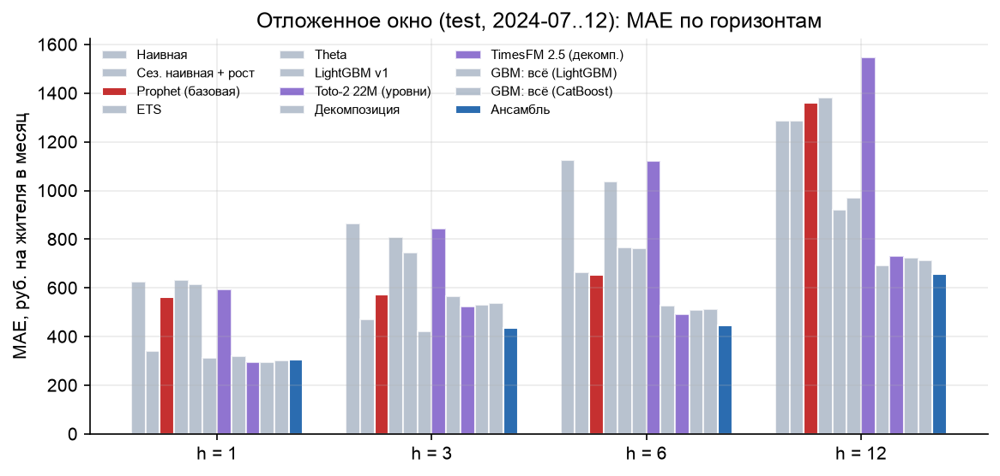

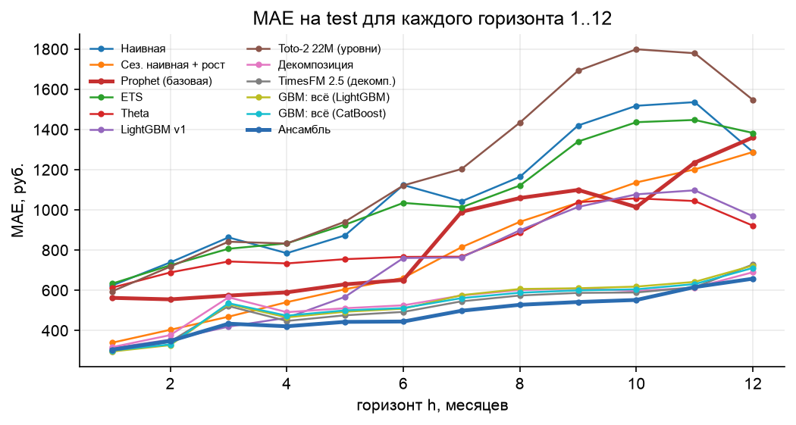

Выводы.

- **Prophet проигрывает всем моделям на декомпозиции на всех горизонтах.** На 24 точках он
  переоценивает тренд и плохо переносит декабрьский пик (смещение +6.8% на h = 12).
- **На h = 12 решает архитектура.** Модели без внешней информации о годовом росте (наивная,
  сезонная наивная, ETS, Prophet) дают 1289-1383. Национальная компонента с ростом из Росстата
  снижает ошибку до 658-729.
- **На h = 1 почти все сильные модели близки (296-318).** Ансамбль (306) немного хуже лучшей
  одиночной модели: веса выбраны на validation, а не на test.
- **На h = 3 лучший одиночный результат у LightGBM v1 (420).** На validation он был хуже
  (676), поэтому ансамбль его не выбрал. Это честная цена выбора без подглядывания в test.
- **Ансамбль лучший на h = 6 и h = 12** и второй на h = 3. Состав весов (validation):
  h = 1 — сезонная наивная с учётом сдвигов 0.35, Theta 0.25, TimesFM 2.5 0.15, остальное 0.25;
  h = 6 — TimesFM 2.5 на локальной компоненте 0.55; h = 12 — GBM 0.45, Theta 0.25, Prophet 0.15.
  Prophet вошёл в ансамбль на h = 12: его ошибки слабо коррелируют с остальными.

### 6.2. Значимость и дополнительные метрики

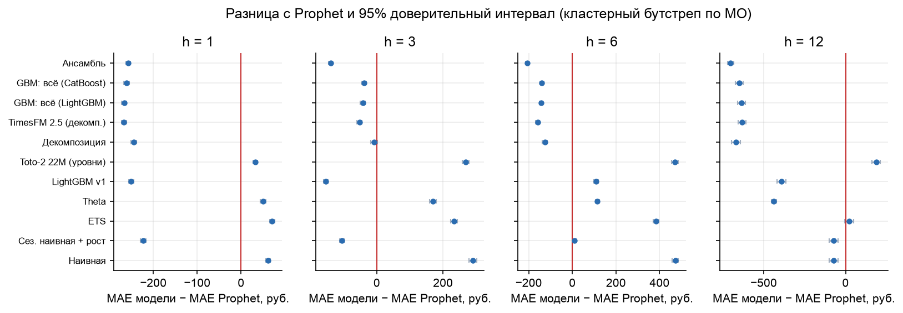

| Метрика (test) | Ансамбль h = 1 / 3 / 6 / 12 | Prophet h = 1 / 3 / 6 / 12 |
|---|---|---|
| MAE, руб. | 306 / 435 / 446 / 658 | 563 / 574 / 652 / 1361 |
| R² (уровни) | 0.998 / 0.996 / 0.995 / 0.991 | 0.991 / 0.992 / 0.990 / 0.954 |
| R² (изменение к origin) | 0.42 / 0.59 / 0.53 / −0.17 | −2.6 / −0.86 / −8.4 / −167 |
| WAPE | 3.3% / 4.7% / 4.9% / 7.2% | 6.1% / 6.3% / 7.1% / 14.8% |
| MdAPE | 3.7% / 5.3% / 5.4% / 8.1% | 5.6% / 6.3% / 7.5% / 16.7% |
| Смещение | +0.7% / +1.2% / −0.4% / +0.3% | −0.6% / −0.5% / −1.6% / +6.8% |

ΔMAE ансамбля к Prophet и 95% ДИ: h = 1: −258 [−263; −253]; h = 3: −140 [−145; −134];
h = 6: −207 [−215; −199]; h = 12: −702 [−722; −682] руб.

Интерпретация метрик. R² на уровнях высокий у всех моделей и плохо их различает. R² на
изменении показывает, что ансамбль объясняет 42-59% вариации изменения расходов за 1-6
месяцев. На h = 12 R² на изменении отрицательный: годовой рост в основном общий для всех МО,
а ошибка оценки общего роста (≈ 1 п.п.) больше, чем различия между МО. Prophet на изменении
хуже константы на всех горизонтах. Смещение ансамбля мало (|Bias| ≤ 1.2%), у Prophet на h = 12
+6.8%: он экстраполирует тренд первого года.

### 6.3. Фундаментальные модели: преимущества и ограничения

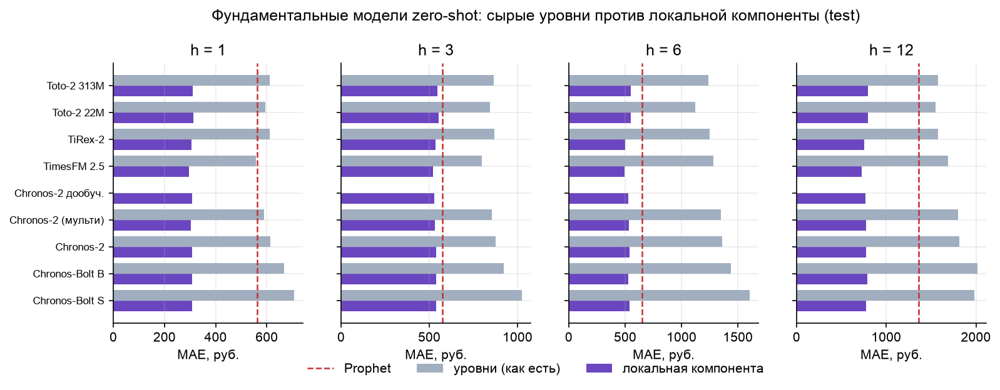

| FM (test, MAE) | уровни h = 1 / 3 / 6 / 12 | лок. компонента h = 1 / 3 / 6 / 12 | покрытие 80% инт., h = 1 / 12 | время, с |
|---|---|---|---|---:|
| Chronos-Bolt S | 707 / 1024 / 1603 / 1986 | 307 / 538 / 539 / 774 | 0.82 / 0.88 | 37 |
| Chronos-Bolt B | 668 / 920 / 1439 / 2015 | 307 / 538 / 529 / 787 | 0.83 / 0.89 | 75 |
| Chronos-2 | 613 / 877 / 1361 / 1817 | 307 / 539 / 540 / 776 | 0.83 / 0.90 | 102 |
| Chronos-2 мультивар. | 588 / 854 / 1351 / 1802 | 302 / 531 / 532 / 772 | 0.81 / 0.91 | 104 |
| Chronos-2 дообуч. | — | 308 / 528 / 527 / 771 | 0.88 / 0.89 | 982 |
| TimesFM 2.5 | 559 / 797 / 1283 / 1691 | **296 / 522 / 493 / 729** | 0.82 / 0.73 | 1028 |
| TiRex-2 | 612 / 870 / 1250 / 1575 | 305 / 535 / 502 / 757 | 0.80 / 0.76 | 3220 |
| Toto-2.0 22M | 595 / 842 / 1122 / 1548 | 313 / 552 / 550 / 799 | 0.74 / 0.88 | 28 |
| Toto-2.0 313M | 611 / 866 / 1240 / 1576 | 310 / 548 / 548 / 794 | 0.82 / 0.87 | 356 |

Время — полный прогон 24 origin × 12 096 рядов на Apple M3 Pro (MPS), при параллельной загрузке
машины другими расчётами.

Выводы по FM.

- **Zero-shot на сырых уровнях не работает:** при h ≥ 3 все 8 вариантов хуже Prophet и
  примерно на уровне наивной модели (797-1024 против 864 на h = 3; 1122-1603 против 1124 на h = 6). Причина — ряды из 7-23 точек с сильным декабрьским пиком. Модель не знает
  календарь и не может выучить сезон из одного года. Это ограничение FM на очень коротких рядах.
- **Корректное применение — на локальной компоненте.** Та же модель без дообучения снижает MAE
  в 1.5-3 раза и обгоняет Prophet на всех горизонтах. На h = 1-3 FM лучше persistence
  (296 против 318 на h = 1), на h = 12 хуже (729 против 691): FM экстраполируют локальный тренд.
- **Лучшая FM — TimesFM 2.5**, но её 80% интервалы на длинных горизонтах узкие (покрытие 0.73
  на h = 12). Семейство Chronos даёт откалиброванные интервалы (0.81-0.91).
- **Мультивариантный Chronos-2** (6 категорий МО как одна группа) немного лучше одномерного
  (302 против 307 на h = 1): совместная динамика категорий несёт информацию.
- **Дообучение Chronos-2** (каузальное, 3 отсечки, 16 минут) даёт −2% на h = 3-6 и улучшает
  покрытие интервалов на h = 1 (0.88 против 0.83). Эффект скромный: в панели всего 24 месяца.
- **Вклад в ансамбль.** Тот же отбор Caruana без всех FM-моделей: 307 / 425 / 473 / 658.
  С FM: 306 / 435 / 446 / 658. FM снижают MAE ансамбля на h = 6 на 5.9%, на h = 1 на 0.5%,
  на h = 12 не входят в ансамбль, на h = 3 ухудшают на 2.4% (веса validation не перенеслись).
- **FM как признаки GBM** почти не помогают (±1%, раздел 6.5): GBM уже видит те же лаги.

### 6.4. По категориям (test, MAE)

| Категория | Ансамбль h = 1 / 3 / 6 / 12 | Prophet h = 1 / 3 / 6 / 12 |
|---|---|---|
| Все категории | 837 / 1147 / 1181 / 1695 | 1792 / 1772 / 2057 / 4060 |
| Продовольствие | 428 / 728 / 672 / 839 | 755 / 744 / 768 / 2070 |
| Маркетплейсы | 334 / 401 / 461 / **927** | 526 / 547 / 593 / **825** |
| Транспорт | 85 / 125 / 140 / 190 | 124 / 157 / 206 / 431 |
| Здоровье | 81 / 98 / 91 / 164 | 91 / 106 / 128 / 449 |
| Общественное питание | 69 / 110 / 127 / 136 | 90 / 120 / 161 / 332 |

Ансамбль лучше Prophet в 23 из 24 ячеек. Исключение — маркетплейсы на h = 12: рост категории
≈ +45% в год, а годовой рост розничной торговли Росстата (≈ +15%) его занижает; трендовая
экстраполяция Prophet здесь уместнее. Улучшение на будущее: категорийный внешний источник роста
(например, доля интернет-торговли Росстата).

### 6.5. Абляция признаков GBM

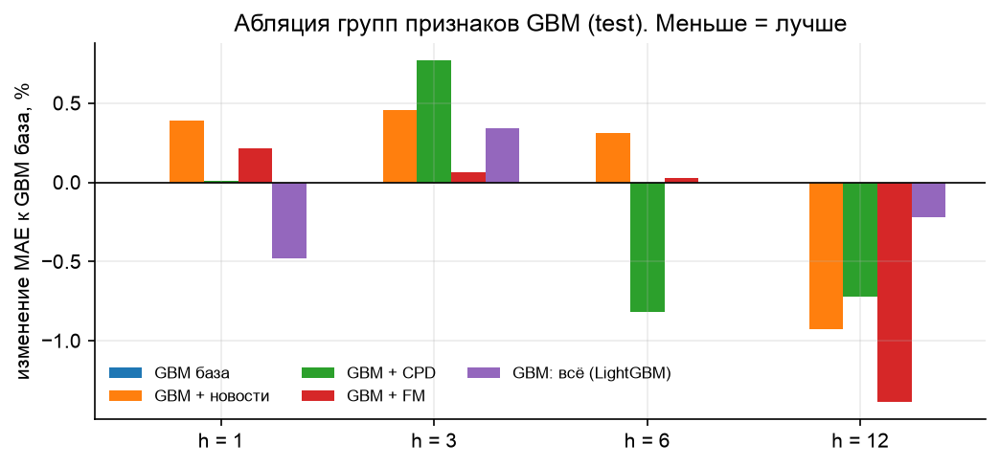

Все варианты GBM отличаются от базового не более чем на 1.4%. Новости: +0.4% (h = 1), −0.9%
(h = 12); на подвыборке МО с новостями в 3 месяцах до origin эффект тот же. Признаки сдвигов:
−0.8% на h = 6. FM-признаки: −1.4% на h = 12. Главные признаки (gain): регион, d год назад
относительно origin, месяц цели, категория, изменение регионального d за 3 месяца.
Вывод: в прогнозе уровня новости дают мало — они редки (новости есть у 575 из 2016 МО) и
англоязычны. Их ценность — в поиске сдвигов (раздел 7) и в объяснении шоков.

## 7. Структурные сдвиги

### 7.1. Методы

Сдвиг ищем в локальной компоненте d (сезонность и инфляция уже убраны). Ряд стандартизуется
робастным масштабом месячных изменений в 2023 г. (MAD).

Онлайн-детекторы (решение в месяце t только по данным до t, запуск с 2024-01):

| Детектор | Идея |
|---|---|
| spike | \|Δz_t\| > k: скачок за один месяц |
| CUSUM | двусторонние кумулятивные суммы отклонений от уровня 2023 г., перезапуск после тревоги |
| PELT, BinSeg, Window (ruptures) | переподгонка сегментации на z[0..t]; тревога, если последний разрыв свежий |
| BOCPD (Adams, MacKay 2007) | апостериорное распределение длины текущего режима, модель Normal-Gamma, hazard 0.05 |
| BOCPD-подтв. | то же, но новый режим должен продержаться 2 месяца (устойчив к выбросам) |
| resid-CUSUM | CUSUM на ошибках локальной сезонной наивной модели |
| CUSUM / BOCPD + новости | порог CUSUM × 0.6 или hazard BOCPD × 5 в месяц новостного всплеска и следующий |

Офлайн-методы (весь ряд сразу): PELT, BinSeg, BottomUp, Window, KernelCPD (rbf), MAP-сегментация BOCPD.

**Честное сравнение.** У каждого онлайн-детектора один порог. Его калибруем на половине рядов
так, чтобы частота ложных тревог на чистых рядах была ≤ 2% на ряд-месяц (подобранные пороги:
spike k = 4, CUSUM h = 8, PELT/BinSeg/Window штраф 12, BOCPD порог 0.7, BOCPD-подтв. 0.8).
Метрики считаем на другой половине. Без такой калибровки сравнение «чувствительность против
задержки» не имеет смысла: любой детектор можно сделать сколь угодно чувствительным.

**Синтетика.** В реальные ряды d («Все категории», 400 МО) вставляем в случайный месяц
2024-02..2024-10 ступеньку 5/10/20/30%, излом тренда 2/4% в месяц или одномесячный выброс 20%
(выброс — не структурный сдвиг: хороший детектор его игнорирует). Метрики: recall и precision
с допуском 2 месяца, F1, средняя задержка, частота ложных тревог.

### 7.2. Результаты на синтетике

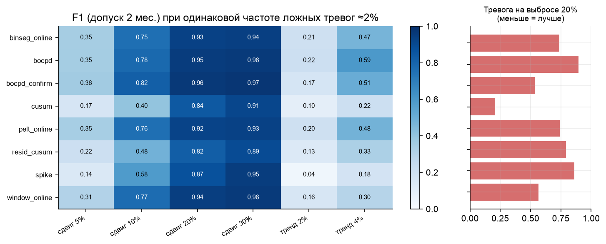

| Детектор | F1, сдвиг 5 / 10 / 20% | Задержка, мес. (сдвиг 10%) | F1, тренд 4%/мес | Тревога на выбросе | Ложные тревоги |
|---|---|---:|---:|---:|---:|
| BOCPD-подтв. | 0.36 / **0.82** / **0.96** | 1.19 | 0.51 | 0.54 | 1.3% |
| BOCPD | 0.35 / 0.78 / 0.95 | 0.34 | **0.59** | 0.90 | 1.6% |
| Window | 0.31 / 0.77 / 0.94 | 1.62 | 0.30 | 0.56 | 1.2% |
| PELT | 0.35 / 0.76 / 0.92 | 0.70 | 0.48 | 0.74 | 1.5% |
| BinSeg | 0.35 / 0.75 / 0.93 | 0.69 | 0.47 | 0.74 | 1.4% |
| spike | 0.14 / 0.58 / 0.87 | **0.00** | 0.18 | 0.86 | 0.8% |
| resid-CUSUM | 0.22 / 0.48 / 0.82 | 0.27 | 0.33 | 0.79 | 1.3% |
| CUSUM | 0.17 / 0.40 / 0.84 | 1.36 | 0.22 | **0.21** | 1.4% |

Офлайн (весь ряд, допуск 1 месяц), F1 при сдвиге 10 / 20%: Window 0.71 / 0.82, PELT 0.66 / 0.76,
BinSeg 0.66 / 0.77, BOCPD-MAP 0.59 / 0.69, BottomUp 0.58 / 0.68, KernelCPD 0.57 / 0.72.
Ошибка положения у PELT и BinSeg при сдвиге ≥ 10% меньше 0.1 месяца.

**Выбор.** Для раннего обнаружения — **BOCPD**: при той же частоте ложных тревог он ловит сдвиг
10% с задержкой 0.3 месяца и лучше всех находит изломы тренда. Его слабость — реакция на
одномесячные выбросы (90%). Для устойчивых сигналов — **BOCPD с подтверждением**: лучший F1
(0.82 при сдвиге 10%), выбросы почти вдвое реже, цена — 1 месяц задержки. CUSUM почти не
реагирует на выбросы (21%), но медленный (1.4 месяца) и пропускает малые сдвиги. Сдвиг 5%
(≈ месячный шум ряда) не обнаруживает надёжно ни один метод (F1 ≤ 0.36): это предел данных.

### 7.3. Реальные данные и новости

Тревоги по месяцам 2024 г. (2016 МО, «Все категории»): BOCPD 13-53 в месяц, PELT 26-66; у CUSUM
число тревог растёт к концу года (с 0 до 91): он накапливает медленный локальный дрейф, поэтому
для реальных рядов CUSUM нужен с осторожностью. Всплеск resid-CUSUM в 2024-04 (100 тревог) —
артефакт: его эталон «год назад» — апрель 2023, где у многих МО есть разрыв в исходных данных
(в офлайн-PELT 341 разрыв из 986 приходится на 2023-04; это край ряда с min_size = 3 или смена методики в источнике).

**Паводок в Орске (прорыв дамбы 5 апреля 2024).** Локальная компонента Орска выросла с +16% к
национальному уровню (апрель) до +24% (май), затем вернулась к +16-17% к августу. Вероятные причины
всплеска (гипотеза, не проверена): выплаты пострадавшим и покупки взамен утраченного имущества. В GDELT за апрель 2024 об Орске
1 367 документов, 1 336 с темой «наводнение» (обычно 0-10 в месяц). Сдвиг +7% близок к пределу
обнаружения: обычные детекторы его не видят; CUSUM поднимает тревогу в июне, **CUSUM с
новостным prior — в мае**, на месяц раньше.

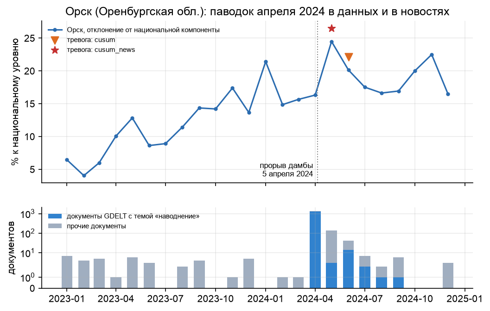

**Новостные события как разметка.** 53 МО-месяца 2024 г. со всплеском документов о бедствиях
(≥ 10 документов и в 3 раза выше среднего за 6 месяцев). Доля событий, после которых детектор
поднял тревогу в 0..2 месяца, против базовой частоты тревог: CUSUM 7.5% против 5.1% (lift 1.5),
CUSUM + новости 7.5% (1.5), BOCPD + новости 3.8% против 3.1% (1.2), BOCPD 0% (lift 0). Большая
часть новостных событий не сдвигает расходы на жителя (пожары, ДТП, новости о крупных городах),
поэтому lift невысокий у всех методов.

**Полусинтетика с новостями** (сдвиг 10%; новость есть у половины сдвигов и в 3% прочих месяцев,
как в реальных данных): CUSUM + новости F1 0.43 против 0.38, задержка 1.1 против 1.5 месяца;
BOCPD + новости 0.73 против 0.78 (рост hazard добавляет ложные тревоги). Вывод: новостной prior
полезен для медленного детектора (CUSUM) и не нужен быстрому (BOCPD).

### 7.4. Как учёт сдвигов улучшает прогноз

Модели с «памятью» о прошлом годе (сезонная наивная, Prophet, признак «d год назад» в GBM)
после сдвига опираются на старый уровень. Поправка: после тревоги точка сдвига уточняется
(разбиение с минимальной суммой квадратов в окне [тревога − 3; тревога]), история до сдвига
переносится на новый уровень, и только потом считается прогноз.

| Синтетика, сдвиг 15%, MAE (руб.) | h = 1 | h = 2 | h = 3 | h = 6 |
|---|---:|---:|---:|---:|
| Локальная сезонная модель (YoY за 3 мес.) | 947 | 1022 | 1164 | 1567 |
| То же с поправкой на сдвиг | **819** | **920** | **1032** | **1397** |
| Изменение | −14% | −10% | −11% | −11% |

На реальных данных (test) поправка в сезонной наивной модели затрагивает 15% рядов на h = 1 и
даёт на этих рядах −0.3% MAE на h = 1 и −1.3% на h = 3; эта модель получила наибольший вес в
ансамбле на h = 1 (0.35). Первая версия поправки без уточнения точки сдвига ухудшала прогноз:
тревога приходит с задержкой, и поправка попадала не на те месяцы (см. LOG.md).

## 8. Интеграция новостей

1. **Сбор.** Ежедневные файлы GDELT GKG 1.0 за 2022-12..2024-12 (761 день, ≈ 33 ГБ; 2023-03-23
   на сервере GDELT отсутствует). Оставляем документы, где есть город или регион РФ:
   **1,55 млн документов**.
2. **Привязка к МО.** GDELT геокодирует шумно (украинские топонимы попадают в российские регионы,
   фамилии распознаются как сёла). Город GDELT привязываем к МО, только если (а) центр МО в
   30 км от точки GDELT и (б) транслитерация названия центра МО или краткого имени МО
   начинается с тех же 5 букв. Так 942 места привязаны к 811 МО. Остальные места считаются на
   уровне региона (по коду ADM1, 81 регион). Таблица привязки сохраняется для аудита
   (`data/external/news_location_match.csv`).
3. **Темы.** Темы GKG извлечены GDELT из текста статьи. Группы: бедствие, наводнение, пожар,
   экономика-негатив (безработица, банкротство, забастовка), цены, инфраструктура, безопасность.
   Тему MANMADE_DISASTER_IMPLIED исключаем: GDELT ставит её на большинство военных текстов.
4. **Признаки** на месяц t (только документы до конца месяца t): log(1 + число документов),
   «сюрприз» (отклонение от среднего за 6 месяцев), число документов по темам, средняя
   тональность; то же для региона.
5. **Использование.** (а) признаки GBM (абляция в 6.5); (б) априорная информация для детекторов
   сдвигов: новостной всплеск снижает порог CUSUM и повышает hazard BOCPD (7.3); (в) разметка
   реальных событий для проверки детекторов (7.3).

Ограничения. GKG 1.0 — англоязычные СМИ; малые МО почти не упоминаются (новости есть у 575 из
2016 МО панели). Русскоязычный поток GDELT 2.0 (Translingual) полнее, но это ≈ 70 тыс.
15-минутных файлов; в рамках конкурса его не загружали.

## 9. Прогноз на 2025 год и практические выводы

Финальный прогноз (origin 2024-12, h = 1..12) делает тот же ансамбль; веса выбраны заново на
validation + test. 80% интервал — эмпирические квантили 10% и 90% логарифмических ошибок
честного ансамбля на test по горизонту и категории. Файл `results/forecast_2025.csv` (145 152
строки: МО, категория, месяц, прогноз, нижняя и верхняя граница).

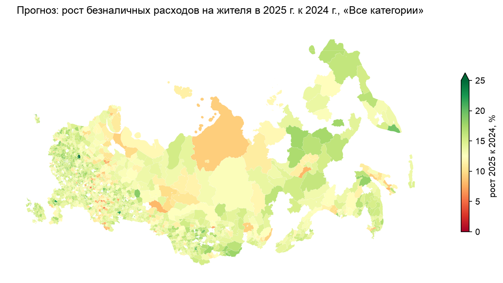

Медианный прогноз декабря 2025 к декабрю 2024: все категории +10.5%, маркетплейсы +24.6%,
общественное питание +13.6%, транспорт +9.9%, здоровье +7.1%, продовольствие +6.2%.

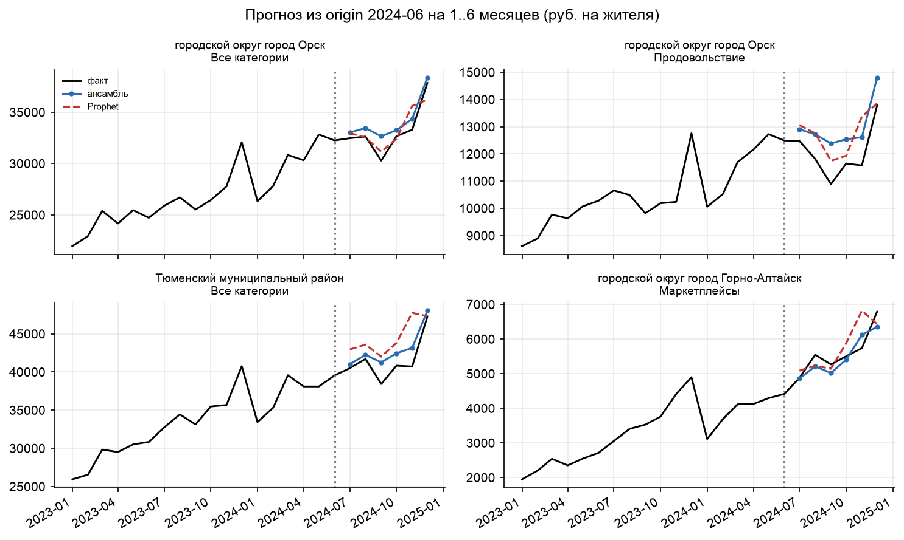

Практические выводы.

- **Для прогноза по МО на короткой истории главное — отделить общую динамику.** Это даёт больше,
  чем выбор модели: декомпозиция с persistence уже снижает MAE к Prophet на 44% / 1% / 19% / 49%.
- **Годовой горизонт требует внешнего источника роста.** Без него h = 12 не прогнозируется.
- **Фундаментальные модели стоит применять к очищенному от сезонности сигналу**, а не к
  «сырым» коротким рядам; лучший выигрыш — на среднем горизонте (h = 6).
- **Мониторинг шоков.** BOCPD с подтверждением даёт устойчивые сигналы с задержкой ~1 месяц;
  для быстрых сигналов — BOCPD; новости ускоряют CUSUM на месяц (пример Орска).
- **Локальный шок не обязательно долгий.** В Орске всплеск расходов после паводка продлился
  ~3 месяца; прогноз после сдвига должен переоценивать уровень, а не продлевать скачок.

## 10. Ограничения

- 24 месяца: окно validation для h = 12 короче по истории, чем test (раздел 3).
- Правило «отдельные (k, w) для h ≤ 3» введено после первого просмотра test (одна итерация
  дизайна, зафиксирована в LOG.md). Оно улучшило h = 1 и ухудшило h = 3 на test; мы его не меняли.
- Нет настоящей разметки шоков; реальная проверка — по новостной разметке и примерам.
- GDELT GKG 1.0 — только англоязычные источники.
- Фундаментальные модели обучались на открытых корпусах; мы не можем исключить, что в них есть
  ряды за 2024 г. (не данные СберИндекса).

## 11. Воспроизводимость

```bash
make setup         # uv + Python 3.13, точные версии из requirements.lock.txt
make data          # данные СберИндекса, справочник МО, Росстат
make reproduce     # все шаги: модели, FM, CPD, новости, ансамбль, прогноз, рисунки, отчёт
```

Все параметры — в `configs/config.yaml` (окна, сетки, гиперпараметры, список FM, темы новостей).
Каждый шаг — отдельный скрипт в `src/` с инструкцией в начале файла; промежуточные прогнозы
кэшируются в `results/cache/`. Полный прогон на Apple M3 Pro: ≈ 4-5 ч (Prophet ≈ 50 мин,
statsforecast ≈ 45 мин, FM ≈ 1.5 ч, GBM ≈ 1.5 ч, загрузка GDELT ≈ 1-2 ч). Журнал экспериментов —
`LOG.md`. Данные организатора в репозиторий не входят (Положение §9.2.2).

При разработке кода использовались инструменты ИИ-ассистирования (Claude Code). Все решения,
результаты и текст проверены автором; автор отвечает за проект.

## 12. Источники

- СберИндекс, данные конкурса: https://sber.ru/sberindex/konkurs_sberindex (CC BY-SA 4.0).
- Росстат, оборот розничной торговли: https://rosstat.gov.ru/statistics/roznichnayatorgovlya.
- The GDELT Project, GKG 1.0: https://www.gdeltproject.org.
- Ansari et al. Chronos (2024); Chronos-2 (2025), amazon/chronos-2, Apache-2.0.
- Das et al. TimesFM (2024); google/timesfm-2.5-200m-pytorch, Apache-2.0.
- NX-AI TiRex-2 (2026), Apache-2.0. Datadog Toto 2.0 (2026), Apache-2.0.
- Adams R., MacKay D. Bayesian Online Changepoint Detection (2007).
- Truong C., Oudre L., Vayatis N. Selective review of offline change point detection methods (ruptures), 2020.
- Caruana R. et al. Ensemble Selection from Libraries of Models, ICML 2004.
- Taylor S., Letham B. Forecasting at Scale (Prophet), 2018.
